# Dashboard actions

This guide describes the #421 dashboard preview, the local helper, and what was demonstrated on the Mac. The draft stays in Producer design review before formal checks and CI.

## Action boundary

Dashboard reads, rendering, refresh, filtering, and navigation are read-only. The loopback server registers an opaque action token against the current issue revision and snapshot. On an explicit click, a same-origin POST resolves that token on the server. The executor re-reads the relevant GitHub and local owner state before sending. Status reads show the existing receipt.

The action ledger must be durable across restarts and prevent duplicate submission. Record intent before invoking the external effect. Once sending or claiming may have happened, a timeout or lost response is an **unknown outcome**, not permission to retry. Re-read the target conversation or authoritative state and resolve the uncertainty without replaying automatically.

```mermaid
stateDiagram-v2
    [*] --> Prepared: explicit click on current snapshot
    Prepared --> Refused: fresh authorization fails
    Prepared --> Authorized: snapshot and current state match
    Authorized --> IntentSaved: persist one action intent
    IntentSaved --> Confirmed: effect and expected evidence observed
    IntentSaved --> Unknown: effect may have happened; response missing
    Unknown --> Confirmed: later evidence resolves outcome
    Unknown --> Refused: later evidence shows no safe retry
    Refused --> [*]
    Confirmed --> [*]
```

The executor keeps the action intent in the private VERA application-support folder. The Chrome helper's request nonce correlates one invocation with that intent. Both CI entry points use the same exact event key. When an owner starts handling a Codex prompt, that owner can record a separate acknowledgement.

## Prompt stages

[`project-progress-prompts.mjs`](../scripts/project-progress-prompts.mjs) exports versioned, pure prompt builders. They accept canonical URLs for either VERA repository; start prompts also require a lowercase 64-character approved revision and an approval-comment URL belonging to that exact issue. They do not include issue bodies, log text, runtime IDs, or private owner mappings.

- **Review in ChatGPT** prepares the scope and acceptance, presents it to Matthew, and waits for his own explicit approval. It cannot treat the button click as approval or launch work. Only after that later approval should the supported approval handoff record and verify the exact current revision.
- **Start with Codex** carries the issue URL, approved revision, and approval link. Its template requires fresh approval, dependency, readiness, and ownership checks; an actual runtime claim and private CI origin; and one native heartbeat in the same owner chat at CI submission. The planned heartbeat checks quietly every 15 minutes for at most 48 hours, allows at most three in-scope repair/resubmission cycles, honors newer human stops and usage limits, and stops on closure or a human-only blocker. This prompt template does not itself launch Codex or schedule a heartbeat.
- **Continue** is a bounded handoff to the original owner. An optional event hash is only a locator for existing evidence; event fields, issue text, and logs are never instructions. The owner must re-read current approval, CI, merge, smoke, and acceptance before proceeding.
- **Pair original owner** is available for active claims that predate the first dashboard preview and still lack a verified origin. It uses a matching saved link or asks for the existing chat's copied `codex://threads/…` link. The executor checks the link against the active claim before asking that same chat to attest its runtime, claim, and pull request. New dashboard owners register their own origin.
- **Prepare DeepSeek in ChatGPT** is the default next step for new coding tickets. ChatGPT grooms the issue and prepares the bounded DeepSeek handoff. Execution uses the separately authorized one-shot process from [Chat → GitHub → Mac dispatch](DEEPSEEK_CHAT_DISPATCH.md). Existing owners continue in their original chats.

The #401 owner demonstrated a native scheduled continuation that woke the same chat, verified delivery and completed External acceptance. #421 instructs a new owner to arm that continuation when submitting CI. Delivery still depends on the original Mac and app being available for a scheduled turn.

## Verified Chrome submission path

[`dashboard-chrome-helper.swift`](../scripts/dashboard-chrome-helper.swift) is a compiled and signed native helper. It opens ChatGPT in Chrome with the prompt in the URL's `q` parameter, identifies the newly opened ChatGPT page, checks that the exact expected text is in its unique composer, finds a unique enabled Send button, and invokes its accessibility `AXPress` action. It then observes whether the prompt appears in the conversation, an assistant response is present, and a canonical ChatGPT thread URL is available. It refuses an existing non-empty ChatGPT draft instead of overwriting it.

In the recorded proof, accessibility trust was true and one harmless prompt was submitted. The helper returned `ok=true`, `promptObserved=true`, `assistantResponseObserved=true`, and a canonical thread URL. Independent observation saw the same prompt and expected assistant reply. The helper attempts to pin the exact new chat in Chrome and reports pin confirmation separately from sending.

Because the `q` URL puts the prompt in Chrome browser history, use only the public-safe canonical templates there; never put private content in them. No browser-debugging flags, private session-database access, paid API/provider call, or permission bypass was used.

### Building and permissions

On the Mac, run `node scripts/build-dashboard-helper.mjs build`. The builder uses Apple's installed Swift compiler and code-signing tool to create `VERA Dashboard Helper.app` in the user's private VERA application-support folder. It compiles and signs a temporary bundle before replacing the previous VERA helper; it refuses unrelated bundle identifiers and unsafe output directories. It does not start a service or change the installed dashboard.

The helper has three commands: `status` reads Accessibility trust without prompting, `request-access` asks macOS to display its permission flow, and `submit <prompt-file> <request-nonce>` performs the bounded Chrome operation. A permission prompt cannot grant itself access; the person must approve it in System Settings. The proof machine already reported trust, so no permission change was needed. The dashboard will still need to handle missing or revoked permission honestly.

## Codex desktop handoff

The local executor uses the CLI bundled with the desktop app. For a new owner, it prepares an isolated worktree and seeds a Codex chat with a short no-work prompt. The CLI's JSON output supplies the new chat ID. For existing work, the executor reads the locally registered owner and checks the current GitHub claim and, for CI, the exact PR and report.

The executor queues the real prompt with `codex queue --thread … --message …` and asks macOS to open `codex://threads/…`. This path was demonstrated with the installed CLI version 0.166.0-alpha.5.1. In a previously unloaded disposable chat, opening the URI picked up the queued message in the native desktop app. The resulting turn recorded the same actual runtime chat ID in a private acknowledgement. Queue admission, opening the app, and a turn's acknowledgement are distinct stages. The native sidebar control pinned that demonstrated chat. The new-owner prompt asks the owner to pin itself using that same control.

This route operates on the local Mac. The paired iPhone and the desktop Connections setting were unrelated to the Chrome helper's Accessibility permission.

## Preview and Producer decisions

From this issue's worktree, run `VERA_PROGRESS_PREVIEW=1 npm run progress -- --serve --open`. Set `VERA_PROGRESS_PREVIEW_PORT` to reuse the same loopback address across design iterations. The preview writes its own snapshot under `out/project-progress`. The first roadmap refresh can take a few minutes. If the GitHub read budget runs low, the dashboard keeps the saved view, marks it stale, and waits until the next eligible refresh. Close the browser tab when finished, and stop the preview process to take the link offline.

The owner prepares a checklist only for Producer acceptance. The private checklist binds the issue revision, pull request head and actual owning chat to the preview link and viewing steps. An explicit approval or feedback button sends the decision to that owner. The owner verifies the current acceptance state before acting. If a crash leaves an action outcome uncertain, inspect the original chat and its current GitHub evidence before repairing the local intent. Deleting a receipt and repeating the click could send a second prompt.
