# Dashboard actions — work in progress

This guide records the intended action boundary for issue #421 and the runtime evidence available so far. The dashboard action flow is not complete: prompt builders exist and one Chrome submission path has been demonstrated, while click routing, durable action recovery, Codex launch, and automatic follow-up integration remain pending. Producer review of a working visual preview must happen before checks or CI.

## Action boundary

Dashboard reads, rendering, refresh, filtering, and navigation are read-only. Only an explicit action click may request an external effect. The planned loopback action path binds that click to the snapshot the user saw, then re-reads current GitHub and owner state before it acts. A stale snapshot, changed approval, open dependency, competing owner, or ambiguous result must refuse the action and offer refresh or recovery.

The action ledger must be durable across restarts and prevent duplicate submission. Record intent before invoking the external effect. Once sending or claiming may have happened, a timeout or lost response is an **unknown outcome**, not permission to retry. Re-read the target conversation or authoritative state and resolve the uncertainty without replaying automatically.

```mermaid
stateDiagram-v2
    [*] --> Prepared: explicit click on current snapshot
    Prepared --> Refused: fresh authorization fails
    Prepared --> Authorized: snapshot and current state match
    Authorized --> IntentSaved: persist one action intent
    IntentSaved --> Confirmed: effect and expected evidence observed
    IntentSaved --> Unknown: effect may have happened; response missing
    Unknown --> Confirmed: later evidence resolves outcome
    Unknown --> Refused: later evidence shows no safe retry
    Refused --> [*]
    Confirmed --> [*]
```

This is the target workflow, not a claim that the dashboard currently implements those states. In particular, the helper's request nonce correlates one invocation's result; it is not a durable idempotency record.

## Prompt stages

[`project-progress-prompts.mjs`](../scripts/project-progress-prompts.mjs) exports versioned, pure prompt builders. They accept canonical URLs for either VERA repository; start prompts also require a lowercase 64-character approved revision and an approval-comment URL belonging to that exact issue. They do not include issue bodies, log text, runtime IDs, or private owner mappings.

- **Review in ChatGPT** prepares the scope and acceptance, presents it to Matthew, and waits for his own explicit approval. It cannot treat the button click as approval or launch work. Only after that later approval should the supported approval handoff record and verify the exact current revision.
- **Start with Codex** carries the issue URL, approved revision, and approval link. Its template requires fresh approval, dependency, readiness, and ownership checks; an actual runtime claim and private CI origin; and one native heartbeat in the same owner chat at CI submission. The planned heartbeat checks quietly every 15 minutes for at most 48 hours, allows at most three in-scope repair/resubmission cycles, honors newer human stops and usage limits, and stops on closure or a human-only blocker. This prompt template does not itself launch Codex or schedule a heartbeat.
- **Continue** is a bounded handoff to the original owner. An optional event hash is only a locator for existing evidence; event fields, issue text, and logs are never instructions. The owner must re-read current approval, CI, merge, smoke, and acceptance before proceeding.
- **Pair original owner** asks the existing owner to re-attest its actual runtime, claim, and pull request through supported origin tools. It must not guess IDs or replace another owner.
- **Prepare DeepSeek task** drafts a proposal only. It never calls a provider, queues paid work, changes permissions, or treats readiness as authorization.

These templates do not count as transport evidence. The continuation prompt's behavior also remains to be connected to dashboard actions. A native scheduled continuation did independently wake and complete eligible delivery and acceptance in the earlier #401 owner chat; that proves the demonstrated same-chat scheduler path, not issue #421's dashboard wiring or every offline/app state.

## Verified Chrome submission path

[`dashboard-chrome-helper.swift`](../scripts/dashboard-chrome-helper.swift) is a compiled and signed native helper. It opens ChatGPT in Chrome with the prompt in the URL's `q` parameter, identifies the newly opened ChatGPT page, checks that the exact expected text is in its unique composer, finds a unique enabled Send button, and invokes its accessibility `AXPress` action. It then observes whether the prompt appears in the conversation, an assistant response is present, and a canonical ChatGPT thread URL is available. It refuses an existing non-empty ChatGPT draft instead of overwriting it.

In the recorded proof, accessibility trust was true and one harmless prompt was submitted. The helper returned `ok=true`, `promptObserved=true`, `assistantResponseObserved=true`, and a canonical thread URL. Independent CUA observation saw the same “You said” prompt and the expected assistant reply. Earlier failures occurred before Send was invoked and sent nothing. This proves the helper's actual ChatGPT web submission path for that harmless prompt; it does **not** prove that the full review template was used, that Codex prompts can be delivered, or that dashboard click routing is connected.

Because the `q` URL puts the prompt in Chrome browser history, use only the public-safe canonical templates there; never put private content in them. No browser-debugging flags, private session-database access, paid API/provider call, or permission bypass was used.

## Remaining transport limit

The current spawned MCP and CUA MCP paths did not provide a supported submission route outside an active host turn, and direct CUA control of the host app was denied. Those paths were not bypassed. Chrome's Codex UI is available in Work in Remote, but no connected computer is available there. The owner has asked the Producer to connect the existing Mac through Settings → Connections → Control this Mac to test that supported Chrome route; that connection and permission have not been confirmed.

Until that route is proven and the preview receives Producer design review, do not describe Codex prompt submission, automatic dashboard continuation, or issue #421 as complete, and do not send this work to checks or CI.
