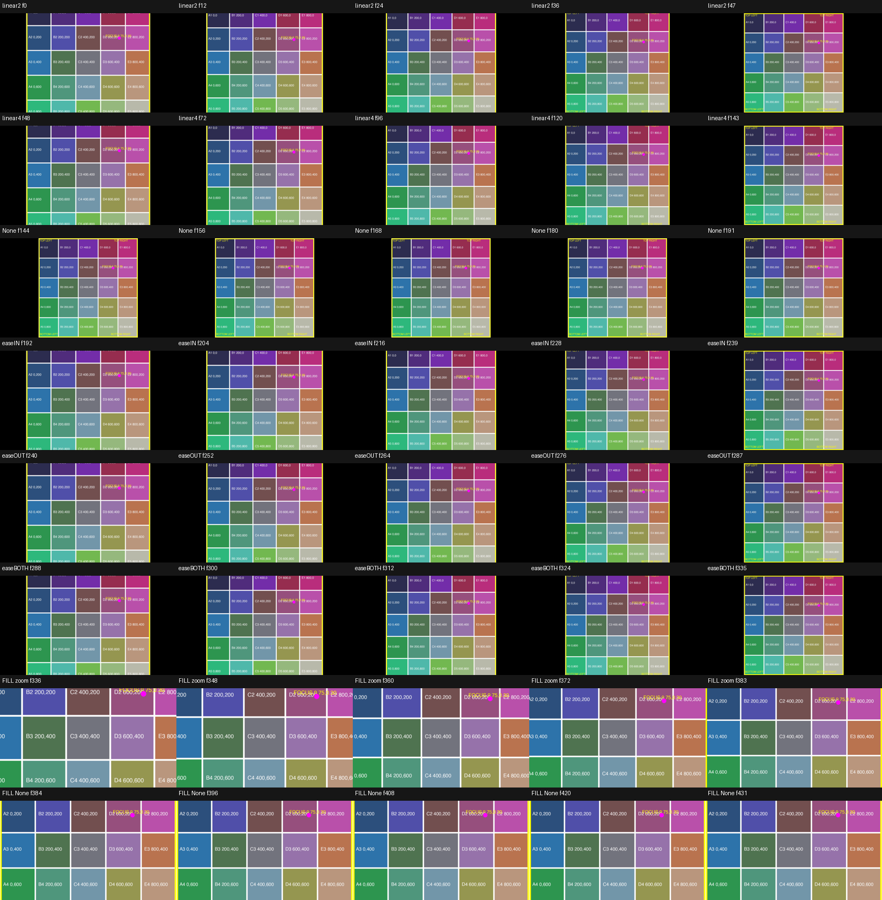
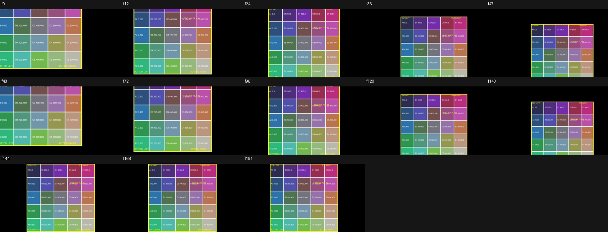

# Native image zoom qualification (#325)

2026-10-25. **Partial capability result:** native Dynamic Zoom produces motion
and explicit None in Studio, and native OTIO metadata can retain custom center
and scale endpoints. This does **not** qualify exact normalized focus,
contain/background composition, non-linear easing, in-place trimming, or Free
delivery. #164 and #319 must consume these limits; the functional promise and
the existing design feasibility hold are not cleared by this investigation.

The Producer's [later image-default decision](https://github.com/mbelinkie/vera-script-to-timeline/issues/164#issuecomment-6399451899)
supersedes the older static-default wording in Product Spec §8.4. Automatic
zoom remains the requirement, with settings and explicit None. No production
implementation or design restart is included here.

## Installed route and retained experiment

| Pin | Actual value |
| --- | --- |
| Product | DaVinci Resolve **Studio** |
| Version/build | `21.1.1.10` (`GetVersionString`) |
| Route | External scripting; native `SetProperties`; native Resolve OTIO export/import |
| Picture | 1280 × 720, square pixels, 24 fps, ProRes 422 render |
| Source | Generated 1000 × 1000 labeled grid, magenta target at source `(750,300)` |
| Source bytes | `c52450d978e472ddc4d9835308f38c5d1c1be15c3c99ff3e5d8e2027fcfed36b` |
| Disposable project | `VERA325 Native Zoom 20261025 A`, new local project |
| Save/reopen | SaveProject → CloseProject → LoadProject; **not** a process restart |
| Free / manual | No Free runtime test and no manual/UI operation performed |

The checked-in [grid](issue-325/grid.png), [native values](issue-325/native-results.json),
[API refusals](issue-325/api-negative.json), [frame measurements](issue-325/frame-measurements.json),
and [decoded comparisons](issue-325/decoded-comparison.json) are public synthetic
evidence. Complete local OTIO/readbacks/renders and an exported `.drp` are
retained under `~/.local/share/vera/issue325-native-zoom/`; the source checkout's
`out/issue325-native-zoom/` is also preserved. No private media, original target,
installed release, prior issue target, provider or UI automation was used.

## What the real application did

| Request/check | Observed result | Qualification |
| --- | --- | --- |
| Append still with source ranges 48 and 96 frames | Both became **120 frames** (five seconds) | Append range does not set occurrence duration for this still |
| Native OTIO source-range durations | 48 and 96 frames; rebuilt revisions 24 and 144 frames, exact getters and rendered extents | Qualified reconstruction at 1/2/4/6 seconds, not native trim |
| `DynamicZoomEnabled=true`, ease `0`, fit `2` | Centered zoom **out** over the whole occurrence | Qualified default motion on this source/profile |
| Explicit `DynamicZoomEnabled=false` | Static, complete 720-pixel square with black pillarbox; all 48 decoded frames identical | Qualified None with fit |
| Ease `0/1/2/3` | All setters/readbacks retained values; imported ease 1/2/3 clips each matched linear's **entire 48-frame decoded sequence** | Non-linear visual easing **unqualified** on this route |
| Scaling `2` (fit) / `3` (fill) | Fit preserves source aspect with side space; fill cuts off top/bottom of the square | Explicit scaling works; fit plus zoom is not whole-image contain |
| Direct `DynamicZoomStart` / `DynamicZoomEnd` | False; all properties unchanged | Unsupported keys, no custom framing through this call |
| Direct `Duration=24`, `SetSpeed(200%, ripple, stretch keyframes)` | False; duration stayed 48 | No in-place duration-changing route qualified |
| Native OTIO center/scale endpoints | Custom motion rendered at 48 and 96 frames and survived reopen | Bounded raw-metadata route, not an accepted normalized-focus contract |
| Extreme raw center values | Retained successfully, but rendered black endpoints/quarter frames | Native import does not protect framing; refuse unqualified coordinates |
| `BackgroundColor=#204080` | False; properties unchanged | Custom background not qualified through item properties |
| Project default fit → `scaleToCrop` | Earlier use-project clip changed from complete square to crop | Never leave frozen builds dependent on live defaults |
| Earlier explicit fit/fill timeline after default change | All **432 decoded frames identical** | Explicit occurrence settings preserve this earlier frozen output |
| Custom-motion timeline after save/reopen | All **192 decoded frames identical** to pre-close output under same project default | Persistence qualified for retained raw parameters |

`scaleToFill` is not an accepted project-setting value (False); the installed
documentation names `scaleToCrop`, which returned True and read back correctly.
There is no qualified project-wide Dynamic Zoom default API here: the adapter
must resolve the chosen default to explicit per-occurrence settings when it
creates a new build. A new use-project occurrence still reads `Scaling=0` and
inherits the changed default. No production freezing implementation is claimed.

The first queued render reported Complete but produced no file after the
experiment switched timelines immediately. The log recorded zero frames.
Repeating with the render timeline held fixed produced the expected 432-frame
file. Later comparisons require actual files, decoded counts and pixels; job
status alone was not treated as evidence. No outstanding render remains.

## Endpoints, easing and duration limits

The exported native Dynamic Zoom effect is type `59`. Its raw parameters are
`dynamicZoomCenter` (`POINTF`) and `dynamicZoomScale` (`Double`). The preserved
key labels are `-86400` and `-85400`; these are **opaque native metadata**, not
timeline frame addresses. Changing only occurrence duration rescales progression
without changing these keys. Default centers are `[0,0]`, scales `0.8 → 1.0`.

The centered fit render's nonblack horizontal width at start, quarter, half,
three-quarter and last frame was:

| Duration | Widths in pixels |
| --- | --- |
| 24 frames | 900, 848, 800, 758, 726 |
| 48 frames | 900, 848, 800, 758, 724 |
| 96 frames | 900, 848, 800, 758, 722 |
| 144 frames | 900, 848, 800, 758, 722 |
| None, 48 frames | 720, 720, 720, 720, 720 |

This matches duration-relative progression, with a last-frame convention that
does not reach the exact final 720-pixel static image. Measurements use decoded
ProRes pixels above brightness 30; edge rounding is included. At start the
900-pixel-tall square is clipped to the 720-pixel frame, losing about 90 source-
scaled pixels at each vertical edge. Do not advertise exact requested endpoint
coverage or whole-image visibility from `Scaling=fit` alone.

For the smaller custom experiment, raw center `[0.25,-0.2] → [-0.25,0.2]`
and scale `0.8 → 1.1` produced visible movement at 2 and 4 seconds. At 2 seconds,
the target-dot positions at sampled frames were approximately `(641,5)`,
`(743,113)`, `(831,208)`, `(905,290)`, `(964,354)`. They are **not** proof that
requested normalized source focus `(0.75,0.30)` maps to a specified output
position. Coordinate sign/units, focus-to-frame mapping, clamping, reverse
direction, and arbitrary source/timeline aspect ratios remain unqualified.

The deliberately extreme request `[-180,144] → [180,-144]` was accepted and
persisted, but only the midpoint showed the grid; endpoints and quarter samples
were black. This demonstrates why accepting an import/readback is insufficient.

## Refusals and smallest next route

The small [probe preflight](../../scripts/issue325_zoom_probe.py) is an
investigation-only boundary, not a shipping adapter. It checks source bytes,
exact runtime/profile, tested durations, explicit motion/None, linear ease,
fit/fill and black background **before returning properties**. It rejects
unknown fields/custom focus, unsupported ease/framing/background, stale source,
stale profile, and an attempted Free-edition substitution. It never modifies a
timeline, chooses a replacement preset, or constructs duration implicitly.
Its unit tests prove these local refusals; the retained application evidence
separately proves native behavior. It does not make unsupported native imports
safe or qualify stale-source handling in production.

The smallest native continuation is a bounded Resolve-OTIO adapter around the
exported Dynamic Zoom effect, with independently checked focus mapping and
output geometry. The raw metadata path already animates and persists custom
centers; there is no evidence requiring an animation engine. For a chosen
background, a precomposed still/matte feeding native motion is the smallest
fallback candidate after the demonstrated missing background control, but its
source → matte → motion output and contain limits still need a separate proof.
Neither candidate is implemented here. #164 must settle the exact contract and
#319 must preserve acquisition/source identity; numeric motion taste stays open.

Free delivery remains **untested**, including importing this native metadata.
A future Free/manual proof must use an actual Free build, import the public
grid/package, inspect start/quarter/mid/last frames, shorten/lengthen, choose
None, save/reopen, and compare output. A Studio `.drp` or interchange file is
only a candidate input, not Free capability evidence. There is no UI-automation
workaround or request to resume design in this result.

## Verification and delivery

Focused probe tests and Python lint/type checks pass. The full cloud gate,
local fast gate, required Claude review, merge, and External closure are tracked
in the PR. This document's partial capability verdict is distinct from delivery
status; #325 is not complete until its PR is merged with the required checks.
